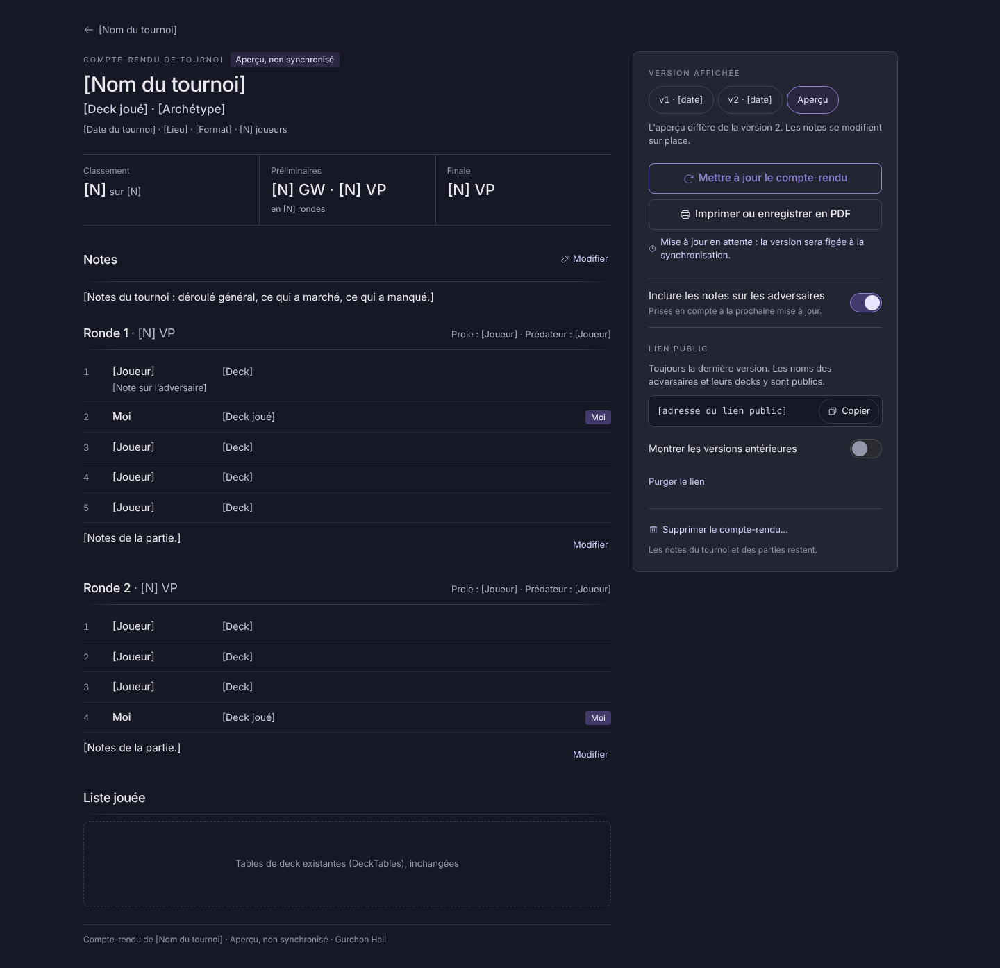
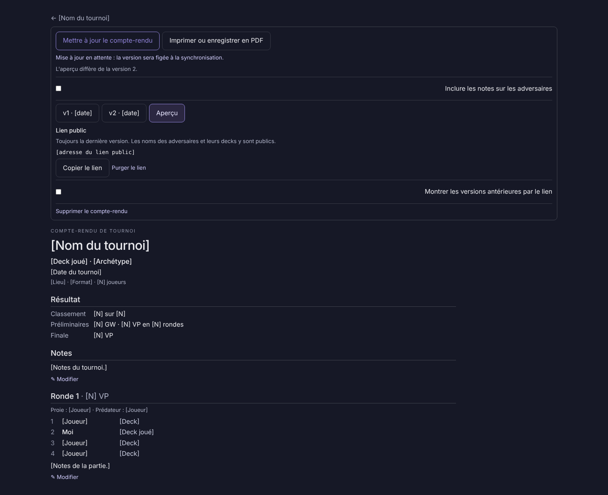
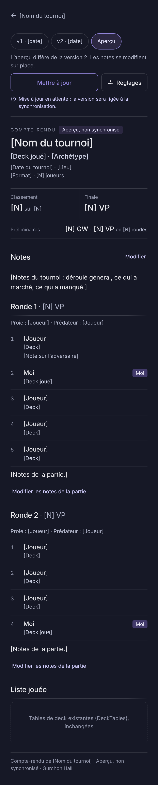
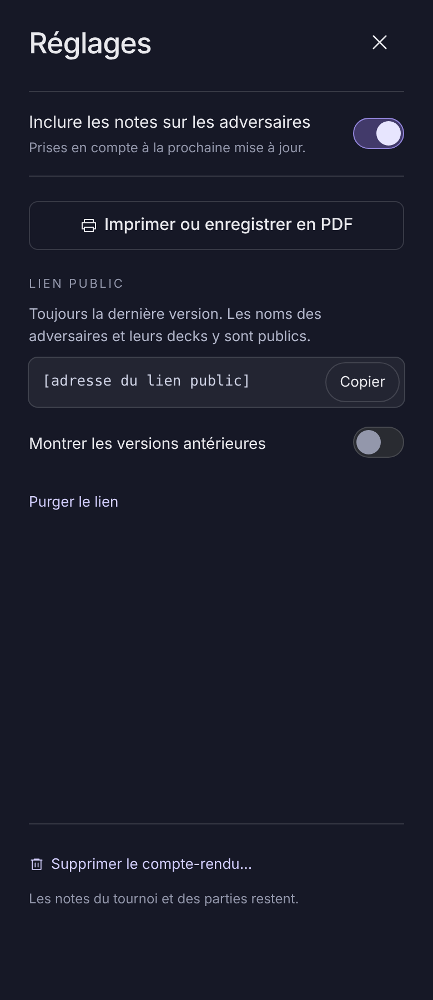

# Handoff Compte-rendu de tournoi — écran du propriétaire

Ce handoff complète [`COMPTE-RENDU.md`](COMPTE-RENDU.md), qui couvre seulement la page imprimée. Celui-ci traite
de l'apparence de l'**écran** `#/tournois/<clé>/compte-rendu` (`TournamentReportPage`), en
mobile et au bureau. Le comportement ne change pas : mêmes routes, mêmes données, même file
hors ligne, mêmes conditions de partage et mêmes `data-testid`. Le plan
`docs/lot-compte-rendu-plan.md` fait foi pour les règles (P1 à P12).

Produit le 2026-11-27 dans Claude Design, avec le design system « Nocturne — Gurchon Hall ».
Code relevé au commit `681b844`.

## Fichiers

- `Gurchon Hall Compte-rendu Bureau.dc.html` : bureau, ≥ 1024 px. Interactif : le choix de
  version et les interrupteurs répondent.
- `Gurchon Hall Compte-rendu.dc.html` : mobile, < 1024 px. Interactif. « Réglages » ouvre la
  maquette suivante.
- `Gurchon Hall Compte-rendu Reglages.dc.html` : la feuille Réglages en mobile.
- `Gurchon Hall Compte-rendu Avant.dc.html` : l'écran actuel, reconstitué à la lecture de
  `TournamentReportPage.tsx`, `ReportView.tsx` et d'`index.css`. Il sert de référence « avant »
  et ne vient pas d'une capture de l'application.
- `sources/compte-rendu-ecran/cap.py` : le script des captures (Playwright, Chrome). React,
  Babel et Inter y sont servis par des paquets npm locaux, comme dans `sources/lot12/cap.js`.

Les maquettes chargent `support.js` comme les autres `.dc.html`. Pour les ouvrir, servir le
dossier en HTTP.

**Données fictives.** Tout le contenu est entre crochets : [Nom du tournoi], [Joueur],
[N] VP… Les listes jouées sont représentées par un cadre vide, parce que `DeckTables` ne change
pas.

## Captures

Même format que les lots précédents : 390 px de large à l'échelle 2 en mobile, 1440 px à
l'échelle 1 au bureau.

| Capture | Écran |
| --- | --- |
| `screenshots/desktop/d50-compte-rendu-apercu.png` | Bureau, aperçu sélectionné, notes modifiables |
| `screenshots/desktop/d51-compte-rendu-version.png` | Bureau, version 2 sélectionnée, lecture seule |
| `screenshots/desktop/d52-compte-rendu-avant.png` | État actuel (référence) |
| `screenshots/1b-79-compte-rendu-apercu.png` | Mobile, aperçu |
| `screenshots/1b-80-compte-rendu-version.png` | Mobile, version 2 |
| `screenshots/1b-81-compte-rendu-reglages.png` | Mobile, feuille Réglages |

## Ce qui motive la refonte (relevé dans le code)

1. **Interrupteurs mal rendus.** `ReportControls` et `ShareBlock` écrivent
   `<label className="switch-row"><input type="checkbox" />Libellé</label>`, sans la classe
   `.switch` ni la structure `switch-row__text`. Le navigateur dessine donc sa propre case, et
   `justify-content: space-between` place la case à gauche et le libellé contre le bord droit
   (voir `d52`). Le composant `components/Switch.tsx` existe déjà et règle les deux défauts.
   Ce défaut a été déduit du CSS : il n'a pas été vu sur une capture de l'application.
2. **Panneau sans hiérarchie.** Le cadre `.report-panel` empile sept choses dans un ordre qui
   ne suit pas l'usage : actions, attente, écart, option, versions, lien, suppression. Seul
   « Lien public » a un titre.
3. **Version affichée peu visible.** Les puces de version arrivent après l'option des notes, et
   le compte-rendu lui-même ne dit pas s'il montre l'aperçu ou une version figée : seul le
   pied de page le dit.
4. **Résultat et tables peu lisibles.** Le résultat est une liste `dt`/`dd`. Chaque siège est
   une grille `2ch` + nom + deck sans séparation, et la note sur l'adversaire reste collée à
   la ligne.

## Disposition

### Bureau (≥ 1024 px)

Une rangée `flex-wrap: wrap` avec un écart de 32 px :

- **Compte-rendu** : `flex: 999 1 560px; min-width: 0; max-width: 760px`.
- **Panneau de réglages** : `flex: 1 1 320px; max-width: 380px`. Fond `color-surface`,
  `radius-md`, `shadow-sm`, padding 22 px, 22 px entre les groupes. Il n'est pas collant
  (`sticky`) : à trancher (voir plus bas).

Le lien retour (`ArrowLeftIcon` + nom du tournoi) reste au-dessus de la rangée.

### Mobile (< 1024 px)

Une colonne de 560 px au plus, marges de 26 px, 22 px entre les blocs :

1. Lien retour.
2. **Barre de version**, fermée par un filet `color-divider` :
   - les puces de version, dans une rangée qui défile de côté et va jusqu'aux bords ;
   - la phrase d'état ;
   - les boutons « Mettre à jour » (primaire, `flex: 1`) et « Réglages » (secondaire, icône
     `SlidersHorizontalIcon`) ;
   - l'avis d'attente.
3. Le compte-rendu.

« Réglages » ouvre une **feuille** (`Sheet` + `SheetHeader`, titre « Réglages », fermeture
`XIcon`). Elle contient, dans l'ordre : l'option des notes, « Imprimer ou enregistrer en PDF »,
le groupe Lien public et la suppression.

Il ne s'agit pas seulement d'un changement de style : la disposition change d'interaction
(panneau en place ou feuille). Utiliser donc `useIsDesktop()`, et non une media query seule.
La barre d'onglets reste celle de la coquille ; elle n'est pas dessinée dans les maquettes.

## Panneau de réglages (bureau) et feuille (mobile)

Les groupes viennent dans cet ordre. Les titres de groupe sont des kickers (11 px, capitales,
0,16 em, `color-neutral-500`).

1. **Version affichée** (kicker, bureau seulement ; en mobile, la barre de version la remplace).
   - Puces : `v1 · 12 nov.`, …, puis `Aperçu` en dernier, comme aujourd'hui (`SelectionBar`,
     mêmes `data-testid`). Hauteur 40 px, `radius-full`, 13 px, chiffres tabulaires. Au repos :
     bordure `color-divider`, texte `color-neutral-300`. Pressée (`aria-pressed="true"`) :
     bordure `color-accent`, fond `color-accent-900`, texte `color-accent-200`.
   - Phrase d'état, 13 px, `color-neutral-400` :
     - aperçu sélectionné : le texte actuel de `previewDiffText` suivi de « Les notes se
       modifient sur place. » ;
     - version sélectionnée : « Version figée, en lecture seule. Passez sur l'aperçu pour
       modifier les notes. » (nouvelle copie).
2. **Actions**, en colonne et pleine largeur au bureau :
   - `Mettre à jour le compte-rendu` : `.btn .btn-primary`, icône `ArrowClockwiseIcon`, 16 px.
     En mobile, le libellé court est « Mettre à jour ».
   - `Imprimer ou enregistrer en PDF` : `.btn .btn-secondary`, `PrinterIcon` (inchangé). En
     mobile, ce bouton passe dans la feuille.
   - L'avis `report-pending` est inchangé : `ClockCountdownIcon`, `color-accent-300`, 13 px.
3. **Inclure les notes sur les adversaires** : `<Switch>`, avec l'aide « Prises en compte à la
   prochaine mise à jour. » (nouvelle copie). L'aperçu suit l'interrupteur tout de suite, comme
   aujourd'hui.
4. **Lien public** (kicker) :
   - le texte d'avertissement est inchangé ;
   - le lien est dans un champ : hauteur 44 px, fond `color-bg` (`color-surface` dans la
     feuille), `shadow-sm`, police mono de 13 px, coupé par une ellipse. Le bouton « Copier »
     est une pilule de 36 px à droite, avec `CopyIcon`. Le libellé « Copier le lien » devient
     « Copier » et gagne `aria-label="Copier le lien"` ;
   - sans lien : « Créer le lien » et sa raison de blocage, comme aujourd'hui ;
   - interrupteur « Montrer les versions antérieures » : le mot « par le lien » tombe, puisque
     le titre du groupe le dit déjà ;
   - « Purger le lien » : `.btn-danger-text`, inchangé.
5. **Suppression**, séparée par un filet :
   - « Supprimer le compte-rendu… » : `.btn-danger-text`, `TrashIcon` ;
   - aide en 12 px, `color-neutral-500` : « Les notes du tournoi et des parties restent. »
     C'est la seconde phrase du `confirm` actuel, montrée avant le clic. Le `confirm` reste.

Les erreurs (`error-text`) restent sous le groupe qui les produit.

## Compte-rendu (`ReportView`)

`ReportView` sert aussi la page publique (`PublicReportPage`). Les points 2 à 5 la changent donc
aussi, ce qui est voulu. L'impression ne change pas : elle a son propre composant
(`ReportPrint.tsx`, `reportPrint.css`).

1. **En-tête.** À côté du kicker, un badge de version (12 px, `radius-sm`, fond
   `color-accent-900`, texte `color-accent-200`) portant le `versionLabel` déjà calculé. Ce badge
   apparaît seulement sur l'écran du propriétaire : ajouter une prop, par exemple
   `showVersionBadge`. Le titre reste en 30 px (26 px en mobile), les decks passent en 17 px
   500 `color-neutral-300`, et la date et les faits sont fusionnés sur une ligne de 13 px
   `color-neutral-400`.
2. **Résultat.** Le titre « Résultat » disparaît. À la place, une grille de trois colonnes
   (Classement, Préliminaires, Finale) entre deux filets, avec un filet vertical entre les
   cellules. Chaque cellule a son étiquette en 12 px `color-neutral-500` et sa valeur en 22 px,
   500, chiffres tabulaires. « sur [N] » et « en [N] rondes » sont en 13 px
   `color-neutral-400`. En mobile, la grille passe à deux colonnes : Classement et Finale, puis
   Préliminaires sur une ligne pleine largeur. Une donnée absente fait disparaître sa cellule,
   comme aujourd'hui.
3. **Titres de section.** 18 px, 500, −0,02 em, suivis d'un filet `.rule--faded` (8 px dessous)
   au lieu de la bordure basse pleine. « Modifier » (`report__edit`) remonte au bout de la
   ligne du titre, en cible de 44 px.
4. **Ronde.** Proie et prédateur passent au bout de la ligne du titre au bureau, et sous le
   filet en mobile. Chaque siège devient une ligne (`padding: 10px 0`), séparée de la suivante
   par un filet `color-divider` à 50 %. La grille a quatre colonnes au bureau :
   `28px minmax(9rem, max-content) 1fr auto`, soit le siège, le nom, le deck et le badge. En
   mobile, elle a trois colonnes (`22px 1fr auto`) : le deck et la note passent sous le nom. La
   note sur l'adversaire prend la colonne 2 jusqu'au bout, en 13 px `color-neutral-400`.
5. **Pied.** Inchangé.

## CSS

- Les règles à reprendre sont celles du bloc « Compte-rendu de tournoi » d'`index.css`, vers
  la ligne 8080. Les classes BEM existantes restent ; ajouter au besoin `report-layout`,
  `report-panel__group`, `report__result-grid` et `report__badge`.
- Les maquettes écrivent des hex en ligne. En production, toujours passer par un token.
- `.report-panel` perd sa bordure pleine au profit de `color-surface` + `shadow-sm` au bureau,
  et devient le contenu de la feuille en mobile.

## À trancher

- **Badge « Moi ».** `seatName` écrit déjà « Moi » ou « Moi (@pseudo) », donc le badge redit le
  nom. Deux choix : garder le badge seul pour repérer la ligne dans une table longue, ou
  l'enlever et garder seulement le poids 500.
- **Panneau collant au bureau** (`position: sticky; top: topbar + 16px`). C'est utile sur un
  long compte-rendu, mais Nocturne n'a pas de panneau collant hors des feuilles.
- **Impression en mobile.** Elle passe dans la feuille Réglages. Si l'impression sert souvent
  sur téléphone, la laisser plutôt dans la barre de version.
